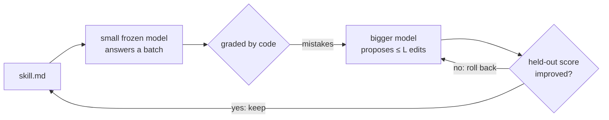

# skillopt-mini

**Train an agent's skill file, not its model weights. Self evolving AI Agent skills without having to fine-tuning models**

A hands-on reproduction recipe for SkillOpt from Microsoft Research
([paper](https://arxiv.org/abs/2605.23904) · [official repo](https://github.com/microsoft/skillopt)):
the core training loop in one readable Python file, running on a free LLM gateway, applied
to a real-world bookkeeping workflow you can adapt to your own.

Companion to my PyCon Ireland 2026 poster. 

> A frozen 20B model went from **0% to 79%** on held-out bank-statement lines in 16 minutes
> on Groq's free tier, by rewriting nothing but a Markdown instruction file.
> [See the live results →](docs/results.md)

---

## Contents

- [The idea in one minute](#the-idea-in-one-minute)
- [What this repo is, and how it relates to the official SkillOpt](#what-this-repo-is-and-how-it-relates-to-the-official-skillopt)
- [The use case: bank statements → ledger](#the-use-case-bank-statements--ledger)
- [Quickstart](#quickstart)
- [What you'll see](#what-youll-see)
- [Repository layout](#repository-layout)
- [Use it for your own workflow](#use-it-for-your-own-workflow)
- [Configuration](#configuration)
- [Limits and honest caveats](#limits-and-honest-caveats)

## The idea in one minute

Agents increasingly run on **skills**: Markdown files of instructions they read before
working. Writing a good skill by hand means guessing every rule your team applies without
thinking. SkillOpt learns those rules from mistakes instead:



It mirrors gradient descent, with text in place of numbers: a forward pass, a backward pass,
a learning rate (at most *L* edits per step), and early stopping on a validation set.
Afterwards you deploy the **small model plus the trained Markdown file**.
[How it works, step by step →](docs/how-it-works.md)

## What this repo is, and how it relates to the official SkillOpt

**The goal is to teach the approach, not to replace the official package.** Use this repo to
understand how SkillOpt works, run it end to end in an afternoon on a free API key, and try
it on your own workflow before committing real compute.

**What's faithful to the paper:** the core mechanism, all of it. A frozen target model,
scored rollouts, an optimizer model that reflects on failures, bounded add / replace /
delete edits, a decaying textual learning rate, the strict validation gate (ties rejected),
the rejected-edit buffer, and the score cache. Nothing in the live results is mocked; every
number comes from real API calls, and every edit is logged in [`runs/`](runs/).

**What's scaled down or left out, and why:** the official implementation runs much bigger
steps (40 rollouts each), analyses failures with 16 parallel workers, merges and ranks the
proposed edits, and adds an epoch-level slow update and meta skill plus Codex and Claude
Code agent harnesses. The paper's runs use roughly **21M–214M tokens per benchmark**. At a
free tier's 8,000 tokens per minute, that's about 43 hours to 18 days per run. Our
bank-statement run used about 157K tokens and took 16 minutes. The parts left out are the
ones that multiply model calls, which a free tier can't afford.

| | Official SkillOpt | skillopt-mini |
|---|---|---|
| Purpose | train production-grade skills; benchmark the method | learn the method; prototype it on your workflow |
| Core loop (rollout → reflect → bounded edit → gate) | ✅ | ✅ same mechanism |
| Parallel reflection, edit merging and ranking | ✅ | ❌ one reflection call per step |
| Slow update and meta skill per epoch | ✅ | ❌ |
| Codex / Claude Code harnesses | ✅ | ❌ direct chat only |
| Scale per run | tens of millions of tokens, frontier optimizer | ~157K tokens, free open models |

[Full comparison, step by step, with the reason for each difference →](docs/official-vs-mini.md)

When your prototype works and you need the full method, move to
[`pip install skillopt`](https://github.com/microsoft/skillopt). The task you built here
(data plus a `check()` function) is most of what it needs.

## The use case: bank statements → ledger

A finance team gets statement exports from several banks and card feeds. Every raw line
must become one ledger row:

```
07/06 SEPA CREDIT ACME ANALYTICS LTD SALARY JUN 5.033,79 CR
  →  {"date": "2026-06-07", "amount": 5033.79, "currency": "EUR", "category": "income"}
```

The right answer follows the team's bookkeeping policy, which the starting skill **never
mentions**:

| Policy | Example |
|---|---|
| Dates are day-first; no year means the statement year (2026); `25` means 2025 | `03/04` → `2026-04-03` |
| EUR exports use a decimal comma and dot thousands | `1.234,56` → `1234.56` |
| Money out is negative; `CR`, refunds and salary are positive | `TO R BYRNE RENT 648,11` → `-648.11` |
| ISO currency codes; no symbol means EUR | `£8.45` → `GBP` |
| A fixed set of 10 categories, with house quirks | refunds are always `refund`; Uber Eats → `dining`, Uber trip → `transport` |

The untrained model invents years, signs and category names. After training:

| | Seed skill (2 lines) | Trained skill |
|---|---|---|
| Held-out test, all 4 fields exact | 0% | **79%** |
| Held-out test, individual fields | 44% | **93%** |
| Unseen November statement (16 lines) | 0 / 16 | **11 / 16** |

## Quickstart

You need Python 3.10+ and a free [Groq API key](https://console.groq.com/keys) (no card).

```bash
git clone <this repo> && cd skillopt-mini
pip install -r requirements.txt           # just the openai SDK

make mock                                 # 1. offline: watch the loop work, no key needed

cp .env.example .env                      # 2. paste your GROQ_API_KEY into .env
make train                                # 3. live training, about 16 min
make demo                                 # 4. untrained vs trained on a new statement, about 2 min
```

No `make`? Every target is one command: run `make help` to see them, or read the
[Makefile](Makefile):

```bash
python skillopt_mini.py --task dates --mock --epochs 3     # offline demo
python skillopt_mini.py --task transactions --epochs 3     # train
python ledger.py statements/nov2026.csv --compare          # deploy
pytest -q                                                  # offline tests
```

## What you'll see

Training prints every step. `.` is a correct answer, `x` a wrong one; `+` marks an edit that
was kept and `x` one that was rolled back:

```
[epoch 2 step 4/9] rollout .x.....x batch acc=75%  lr=2
   validating candidate ..xx...x....
   + append: - Infer currency: default to "EUR" unless a dollar sign ($) appears (use "USD") or a pound sign (£) ...
   + append: - Map descriptions containing keywords such as "fee", "fees", "account maint", "fx fee" to the category "fees"
   val 58% -> 75%  (fields 88% -> 94%)  ACCEPTED
[epoch 2 step 5/9] rollout x....... batch acc=88%  lr=2
   validating candidate .xxxx..x..xx
   x append: - Map descriptions containing keywords such as "rent", "transfer", "to ", "payment to", "card payment" ...
   val 75% -> 42%  (fields 94% -> 85%)  REJECTED, rolled back
...
TEST ACCURACY  0% -> 79%   (fields 44% -> 93%; model weights unchanged)
```

Each run writes a folder you can inspect or commit:

```
runs/transactions-<timestamp>/
├── best_skill.md        the trained skill
├── run_log.json         every proposed edit, with validation before/after and the decision
├── test_before.jsonl    every test answer from the seed skill
├── test_after.jsonl     every test answer from the trained skill
└── summary.json         accuracy, calls, tokens, minutes
```

and copies the trained skill to `skills/transactions.md`, the file you deploy.

The demo (`make demo`) runs the seed skill and the trained skill over
[`statements/nov2026.csv`](statements/nov2026.csv), grades each row against the answer key,
prints a spend report per category, and writes a clean ledger CSV.

## Repository layout

```
skillopt-mini/
├── skillopt_mini.py          the whole SkillOpt loop, in one file, read top to bottom
├── ledger.py                 deployment example: trained skill → ledger CSV + spend report
├── tasks/                    one file per task; each file in here is a --task option
│   ├── transactions.py       bank statement → ledger entry (the main use case)
│   ├── dates.py              messy date → ISO date (a small warm-up task)
│   ├── mock.py               offline fake models for the dates task
│   └── _template.py          copy this to build your own task
├── skills/
│   └── transactions.md       the trained skill from the latest run, ready to deploy
├── statements/
│   └── nov2026.csv           unseen statement with an answer key, for the demo
├── runs/                     committed evidence from the live runs (logs, edits, answers)
├── docs/
│   ├── how-it-works.md       the loop explained, mapped to the paper
│   ├── results.md            live numbers, training trace, remaining errors
│   ├── official-vs-mini.md   what the official SkillOpt does vs this repo, and why
│   └── build-your-own-task.md  turn your own workflow into a task
├── tests/test_offline.py     offline tests (no key); run in CI
├── Makefile                  make mock / train / demo / test
└── .env.example              configuration template
```

## Use it for your own workflow

Any workflow with **one input → one answer**, an **automatic check**, and **house rules the
model doesn't know** fits: support triage, invoice extraction, log classification, product
categorisation, text-to-SQL with execution checks, and more.

```bash
cp tasks/_template.py tasks/ticket_triage.py   # fill in your data and check()
python skillopt_mini.py --task ticket_triage
```

[Step-by-step guide, workflow ideas and troubleshooting →](docs/build-your-own-task.md)

## Configuration

Settings come from `.env` (see [`.env.example`](.env.example)) or the environment.

| Variable | Default | Purpose |
|---|---|---|
| `GROQ_API_KEY` / `LLM_API_KEY` | – | API key (`LLM_API_KEY` wins when both are set) |
| `LLM_BASE_URL` | `https://api.groq.com/openai/v1` | any OpenAI-compatible gateway (Groq, OpenRouter, vLLM, Ollama…) |
| `TARGET_MODEL` | `openai/gpt-oss-20b` | the frozen model that reads the skill |
| `OPTIMIZER_MODEL` | `openai/gpt-oss-120b` | the model that edits the skill (training only) |
| `REASONING_EFFORT` | `low` | leave empty for non-reasoning models |
| `MIN_SECONDS_BETWEEN_CALLS` | `2.0` | minimum gap between calls to the same model |
| `TOKEN_HEADROOM` | `2500` | wait for the rate-limit window when fewer tokens than this remain |

**Free tier budget.** When this was written, Groq allowed each model 8,000 tokens/minute
and 1,000 requests/day. A full `make train` uses about 250 requests and 160K tokens; `make
demo` uses 32 requests. The script reads Groq's rate-limit headers and waits by itself.
Check your current limits at https://console.groq.com/settings/limits.

## Limits and honest caveats

- **The results show the core loop works; they don't reproduce the paper's numbers.** Those
  come from the full method at full scale, with different models and benchmarks.
  [What's included and what isn't →](docs/official-vs-mini.md)
- **The statement data is generated**, following real Irish/EU bank export formats. No
  personal data is used.
- **Small samples.** The test set has 24 lines, so each line is about 4 points of accuracy.
  Results vary somewhat from run to run.
- **It learns what the examples show.** On the November statement, 5 of 16 lines still fail,
  mostly phrasings that were rare in training. [Details →](docs/results.md#the-5-rows-still-wrong-and-why)

## Credits and licence

SkillOpt is by Microsoft Research ([arXiv:2605.23904](https://arxiv.org/abs/2605.23904)).
This repo is an independent re-implementation of its core loop, scaled down so anyone can
run it and learn from it; it isn't affiliated with Microsoft. MIT licence; see
[LICENSE](LICENSE).
