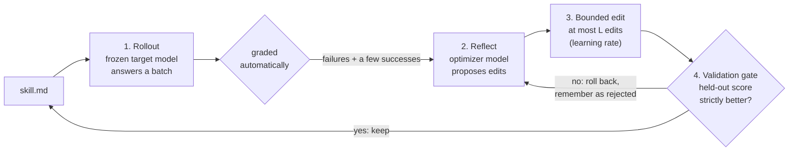

# How it works

SkillOpt treats an agent's **skill file** (the Markdown instructions it reads before working)
as the thing you train. The model's weights never change. A second, larger model plays the
role of the optimizer: it studies the mistakes and rewrites the skill, a few lines at a time,
and only changes that make a held-out score go up are kept.

This page walks through [`skillopt_mini.py`](../skillopt_mini.py) in the order the code runs.

## The loop

Training is the same shape as gradient descent, with text in place of numbers:

| Neural network training | SkillOpt | In the code |
|---|---|---|
| parameters | the skill text | `skill` |
| forward pass | run the frozen model on a batch | `rollout()` |
| loss | automatic check per answer | `task.check()` |
| backward pass | optimizer reads failures, proposes edits | `reflect()` |
| learning rate | max number of edits per step, cosine-decayed 3 → 1 | `learning_rate()` |
| optimizer step | apply add / replace / delete edits | `apply_edits()` |
| early stopping on validation | accept only if validation improves | `val_score()` and the gate in `main()` |
| test set | reported before and after, never trained on | `test_before` / `test_after` |

## The two models

| Role | Default | Used when | Sees |
|---|---|---|---|
| **Target** (frozen) | `openai/gpt-oss-20b` | training *and* deployment | the skill as its system prompt, one input |
| **Optimizer** | `openai/gpt-oss-120b` | training only | the skill, failed and successful runs, edits rejected earlier |

You deploy only the small target model plus the trained skill file. The big model isn't
needed after training.

## Each stage in detail

### 1. Rollout (`rollout`)

For each item in the batch, the target model is called with the **skill as the system
prompt** and the item as the user message. The task's `check()` grades the answer and
returns `(fully_correct, partial_credit)`. In the console, `.` is a correct answer and `x`
is a wrong one.

### 2. Reflect (`reflect`)

The optimizer gets:
- the current skill
- up to 8 failures, each as *input → what the model said → what was expected*
- up to 3 successes, so it doesn't break what already works
- the last 5 rejected edit sets, so it doesn't propose them again

It must reply with JSON edits. The optimizer instructions (`OPTIMIZER_PROMPT`) push for
general rules instead of copied answers, and for stating fixed vocabularies explicitly
without inventing fallback labels.

### 3. Bounded edit (`apply_edits`, `learning_rate`)

Three edit types: `append` a rule, `replace` exact existing text, `delete` exact existing
text. Edits whose target text doesn't exist are dropped. The **textual learning rate**
caps how many edits a step may make: 3 early on (big structural changes), decaying to 1
(small refinements). This stops the skill from being rewritten wholesale on one noisy batch.

### 4. Validation gate (`val_score`)

The candidate skill is scored on the validation split. It is accepted only if the score is
**strictly better**; ties are rejected. Rejected edits are rolled back and remembered.

Two details make this practical on a small budget:
- **Partial credit.** The gate compares the share of correct *fields*, not just fully
  correct rows. On 12 validation items, an exact-match score moves in coarse 8% steps; field
  credit gives a finer signal. Exact match is still what the run reports.
- **Score cache.** Scores are cached by the skill's hash, so a skill is never re-scored.

## Pacing on a free tier

Groq's free tier limits each model to a number of tokens per minute (8,000 when this was
written). `LLM.chat()` reads the `x-ratelimit-remaining-tokens` and
`x-ratelimit-reset-tokens` headers from every response and waits for the window to reset
when the budget runs low. It also keeps a small gap between calls, and the OpenAI SDK retries
any `429` with backoff. The target and optimizer have separate quotas, so they don't slow
each other down.

## How this compares to the official implementation

Every mechanism described above matches the paper: frozen target, scored rollouts,
optimizer reflection, bounded edits, a learning-rate cap, the strict validation gate, the
rejected-edit buffer and the score cache.

The official version adds parts that pay off at scale: parallel reflection with merging and
ranking of edits, an epoch-level slow update and meta skill, and Codex / Claude Code agent
harnesses. Its runs use tens of millions of tokens per benchmark, against about 157K here.

[Full side-by-side comparison, with the reason for each difference →](official-vs-mini.md)
